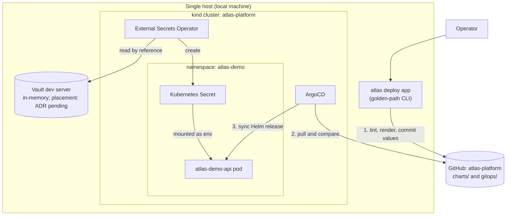

# Atlas Platform

> Platform engineering for the Atlas platform: GitOps with ArgoCD, a Helm
> golden path, and a secrets pattern, built and tested on a local kind
> cluster at zero cost.

**Status: Phase 6 has started. P6-0 (the cluster) and P6-1 (GitOps core) are done; P6-2 to P6-5 are
not started.** A row changes only when its check has been run and the output
is committed.

## Problem Statement

Getting one application onto Kubernetes is easy once. Doing it the same
correct way every time is the hard part: the right labels, probes, network
policy and secret handling, with the cluster state recorded in Git and not in
someone's shell history. Atlas Platform builds that path. The target is a
single command that deploys an application the correct way, with each step
visible and checked.

## A note on anonymization

The sample workload is Tawira, a private SaaS application, shown under the
generic name `atlas-demo-api`, consistent with
[`atlas-security`](https://github.com/spacecode-art/atlas-security),
[`atlas-observability`](https://github.com/spacecode-art/atlas-observability)
and [`atlas-resilience`](https://github.com/spacecode-art/atlas-resilience).
Nothing committed here may identify it or its backing project.

## Overview

Atlas Platform is Phase 6 of the Atlas platform. It will install ArgoCD on a
local kind cluster, describe workloads as Helm releases synced from this
repository, give secrets a reference-only pattern with a Vault dev server, and
wrap the whole flow in one `atlas deploy app` command.

---

## Objectives

- A kind cluster that comes up from one command
- ArgoCD managing workloads from Git, with an app-of-apps layout
- One generic Helm chart that gives every workload the same probes, resource
  limits, pod disruption budget and network policy
- A secrets pattern where Git holds references and never values
- A golden-path command that deploys an application end to end, timed and
  recorded
- Every non-trivial decision recorded as an ADR before it is built on

---

## Milestones

| ID | Milestone | Check that proves it | Status |
|---|---|---|---|
| P6-0 | Foundation: repo, ADR-0001, cluster from one command | Cluster up, `kubectl get nodes` output committed | Done: 2 local runs, 116 s and 89 s ([evidence](docs/evidence/p6-0/)) |
| P6-1 | GitOps core: ArgoCD with a root app syncing one workload | Application reports Synced and Healthy | Done: root and `hello` Synced and Healthy; manual drift reverted within 10 s; one change applied through Git ([evidence](docs/evidence/p6-1/)) |
| P6-2 | Generic Helm chart | `helm lint` and manifest validation pass in CI; sample app deploys | Not started |
| P6-3 | Secrets pattern: Vault dev server and External Secrets | Secret reaches the pod; no value anywhere in Git | Not started |
| P6-4 | Golden path: `atlas deploy app` | One timed end-to-end run, evidence committed | Not started |
| P6-5 | Proof: recorded session | Recording linked; optional single EKS burst demo | Not started |

---

## Run it

Needs `docker`, `kind` and `kubectl` on the host. Built and tested with
Docker 29.9.3, kind 0.33.0 and kubectl 1.36.4 against Kubernetes v1.37.0.

```bash
./scripts/cluster-up.sh     # one control plane and two workers, ~1.5-2 min
./scripts/cluster-down.sh   # deletes only the atlas-platform cluster
./scripts/argocd-up.sh      # Argo CD 3.6.1; pulls images first, can take minutes on a slow link
kubectl --context kind-atlas-platform apply -f bootstrap/root-app.yaml   # the one manual GitOps step
```

The script refuses to run if the cluster already exists. Measured on one
local machine; these are not cloud timings.

---

## Planned Architecture

Intended design. The kind cluster, Argo CD and the root app exist so far; the CLI, Vault and External Secrets do not. It changes as ADRs are
written.



## Repository Structure

Directories are added when they have content. Today the repository holds:

```text
.github/workflows/ci.yml     secrets scan
cluster/kind-config.yaml     1 control plane, 2 workers, pinned node image
bootstrap/                   Argo CD values and the root Application
gitops/apps/                 one Application per workload
gitops/workloads/            workload manifests (hello placeholder)
scripts/cluster-up.sh        create the cluster and wait for Ready
scripts/cluster-down.sh      delete the atlas-platform cluster
scripts/argocd-up.sh         install Argo CD with preloaded images
docs/adr/                    architecture decisions
docs/evidence/p6-0/          P6-0 run output
docs/evidence/p6-1/          P6-1 sync, self-heal and git-change output
CHANGELOG.md
CONTRIBUTING.md
LICENSE
README.md
```

Planned, not yet created: `charts/`, `platform/`,
`cli/`, `examples/`, `tests/`, `measurements/`.

---

## Technology Choices

| Area | Plan | Status |
|---|---|---|
| Cluster | kind | Decided in [ADR-0001](docs/adr/ADR-0001-local-kind-cluster-as-the-platform.md) |
| GitOps | ArgoCD, app-of-apps | Decided in [ADR-0002](docs/adr/ADR-0002-argocd-via-pinned-helm-chart.md) and [ADR-0003](docs/adr/ADR-0003-app-of-apps-layout.md) |
| Packaging | Helm, one generic chart | Planned, ADR pending |
| Secrets | Vault dev server with External Secrets | Planned, ADR pending |
| CLI | Node, with Bash for bootstrap steps | Planned, ADR pending |

Tool versions are pinned when each component is first built, and recorded in
the milestone's evidence.

---

## Cost Model

Zero. Everything runs on a local machine. One optional recorded deployment to
real EKS may follow at the end; it needs its own cost and teardown design
first and is not part of the milestones above.

---

## Design Decisions (ADRs)

- [ADR-0001: Local kind cluster as the platform](docs/adr/ADR-0001-local-kind-cluster-as-the-platform.md)
- [ADR-0002: Install Argo CD from a pinned Helm chart](docs/adr/ADR-0002-argocd-via-pinned-helm-chart.md)
- [ADR-0003: App-of-apps layout for GitOps](docs/adr/ADR-0003-app-of-apps-layout.md)

---

## CI/CD

[`.github/workflows/ci.yml`](.github/workflows/ci.yml) runs on every PR and
push to `main`. Secrets scanning consumes `atlas-security`'s reusable
`reusable-secrets-scan.yml` (pinned to `v1.0.4`). Chart linting and manifest
validation will be added with P6-2.

---

## Security Review

- Secrets scanning is enforced in CI on every PR.
- Secret values never appear in Git; only references do.
- Vault in dev mode is in-memory with a fixed root token. It demonstrates a
  pattern and is not a model of production Vault.

---

## Limits

- A local kind cluster does not prove cloud IAM, load balancer, storage or
  node-group behavior.
- Single runs are observations, not general results. Each result will state
  its run count and environment.

---

## Demo Video

Not yet recorded.

---

## Documentation

Architecture decisions are recorded as ADRs in `docs/adr/`.

## Contributing

Please read [`CONTRIBUTING.md`](CONTRIBUTING.md) before submitting changes.

## License

This project is licensed under the MIT License.
